<div align="center">

# StoryLens QA

**Revisa requisitos, diseña pruebas y mide la calidad de tu software. Con reglas QA y, solo si quieres, con IA.**

[](https://github.com/JuanSGarciaC/storylens-qa/actions/workflows/ci.yml)


[](LICENSE)

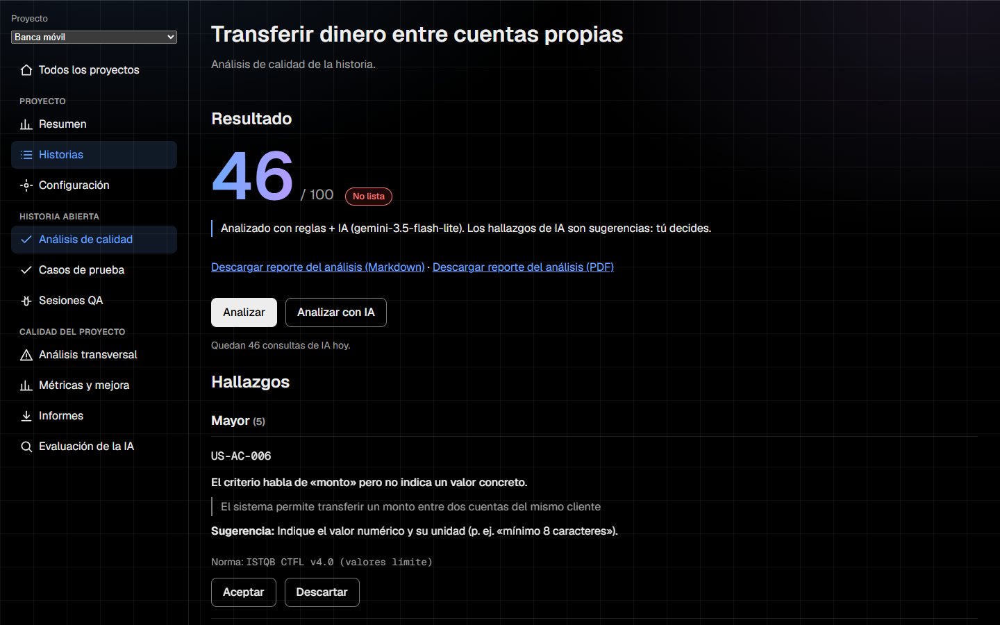

</div>

StoryLens QA toma historias de usuario (escritas a mano o importadas de Jira), detecta lo que está mal redactado **antes** de que se convierta en un defecto, genera casos de prueba trazables, organiza sesiones de ejecución con evidencias y defectos, y resume todo en métricas con su denominador a la vista.

**Idea central:** un motor de reglas determinístico hace el trabajo siempre; la IA solo complementa. Si la IA falla o se agota la cuota gratuita, la app sigue funcionando con las reglas, sin errores. Todo corre **sin costo**.

## Qué incluye

| | Módulo | Qué hace |
|---|---|---|
| 1 | **Proyectos** | Aislamiento de datos, épicas, versiones, reglas y umbrales por proyecto, auditoría |
| 2 | **Historias e importación** | Alta manual o carga de CSV/JSON de Jira (hasta 500 filas) en segundo plano, con progreso y reintentos seguros |
| 3–4 | **Calidad de requisitos + IA** | Reglas citadas a normas (ISO/IEC/IEEE 29148, INVEST, ISTQB), puntaje, hallazgos que se aceptan o descartan, y hallazgos de IA con su confianza |
| 5 | **Análisis transversal** | Duplicados, dependencias, posibles contradicciones (siempre marcadas como hipótesis) y riesgo por épica |
| 6 | **Casos de prueba** | Generación con técnicas ISTQB, Gherkin sugerido y trazabilidad criterio → caso |
| 7 | **Sesiones de QA** | Checklist, resultados, evidencias (notas, enlaces, imágenes) y borradores de defecto |
| 8 | **Informes** | PDF y Markdown por análisis y por sesión |
| 9 | **Métricas** | Cada cifra con su definición y su denominador; «Sin datos» en vez de un cero inventado |
| 10 | **Evaluación de la IA** | Precisión, exhaustividad y F1 contra un conjunto de referencia, solo reglas frente a reglas e IA, y pruebas de inyección de instrucciones |

## Capturas

Tomadas con Gemini real (capa gratuita) sobre una historia de ejemplo de banca móvil.

### Análisis de una historia con IA

Las reglas y la IA conviven en el mismo resultado. Cada hallazgo cita su norma; los de IA llevan su confianza y siempre son sugerencias: tú decides.


### Casos de prueba y Gherkin

<table>
  <tr>
    <td width="50%">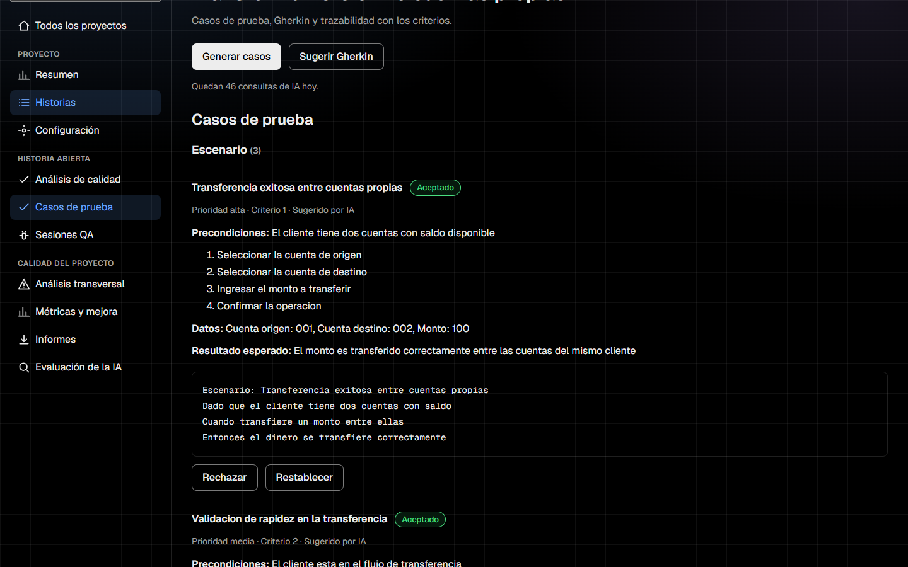<br><sub><b>Casos generados por IA</b>, aceptables o rechazables uno a uno.</sub></td>
    <td width="50%">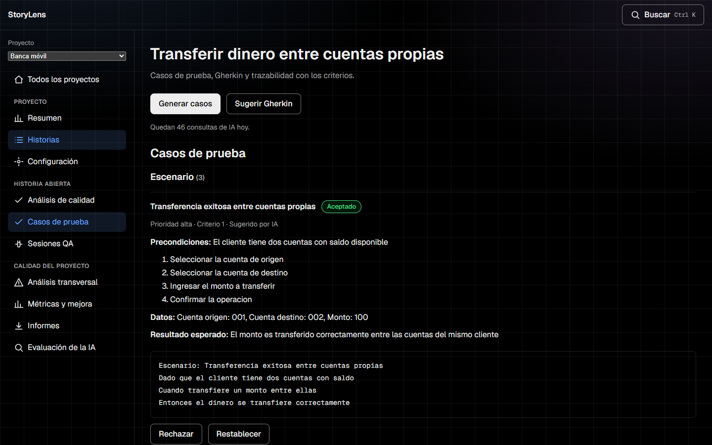<br><sub><b>Gherkin sugerido</b> para automatizar el caso.</sub></td>
  </tr>
</table>

### Sesión de QA con defecto redactado por IA

Resultados, evidencias y un borrador de defecto con la plantilla de ISO/IEC/IEEE 29119-3, para revisar antes de guardar.

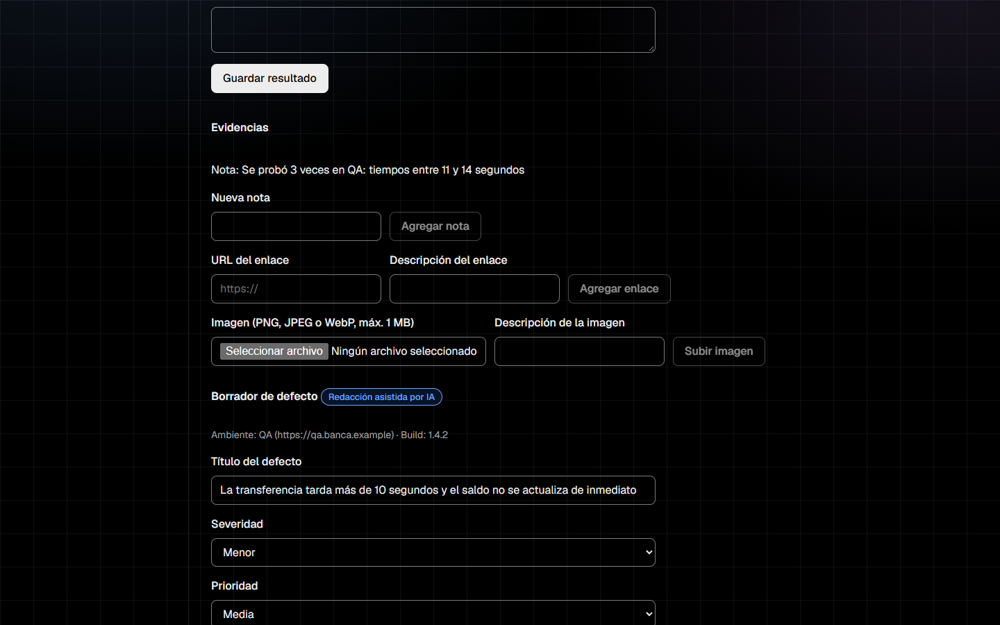

### Visión del proyecto

<table>
  <tr>
    <td width="50%">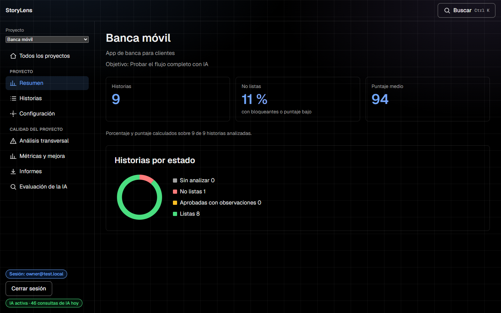<br><sub><b>Resumen</b> con el estado real de las historias.</sub></td>
    <td width="50%">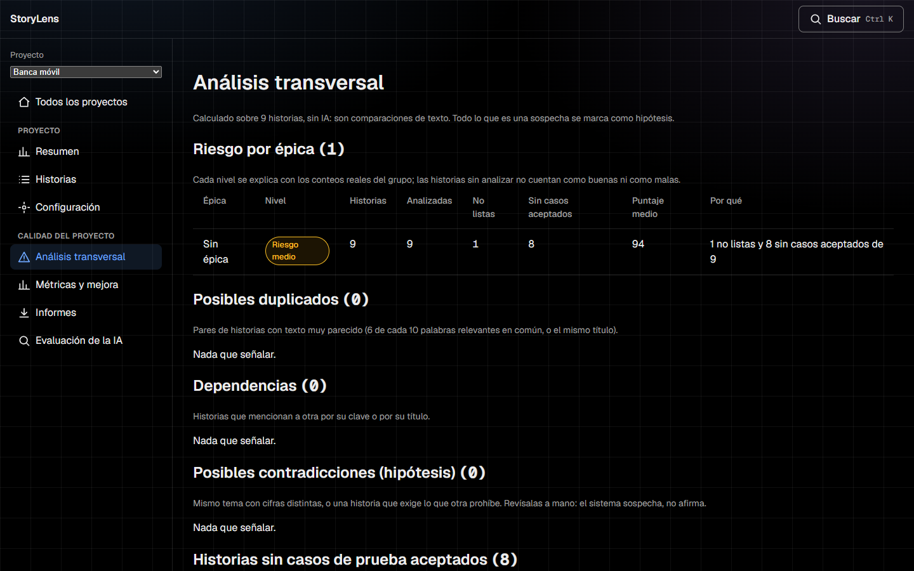<br><sub><b>Análisis transversal:</b> duplicados, dependencias y riesgo por épica.</sub></td>
  </tr>
  <tr>
    <td width="50%">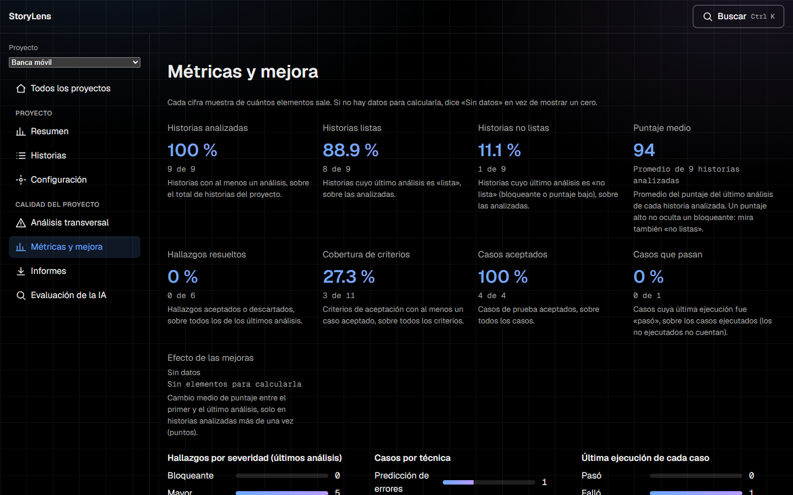<br><sub><b>Métricas</b> con definición y denominador visibles.</sub></td>
    <td width="50%">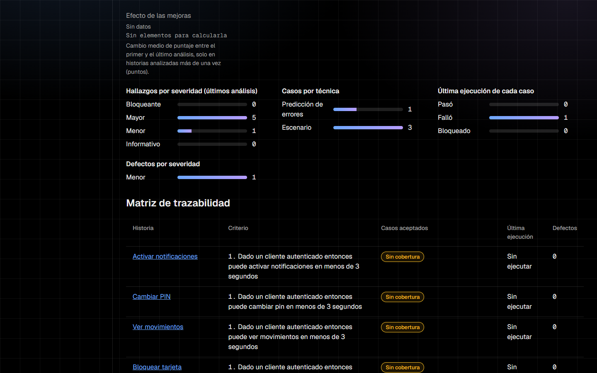<br><sub><b>Matriz de trazabilidad</b> criterio → caso → ejecución → defecto.</sub></td>
  </tr>
</table>

### Importación masiva y evaluación de la IA

<table>
  <tr>
    <td width="50%">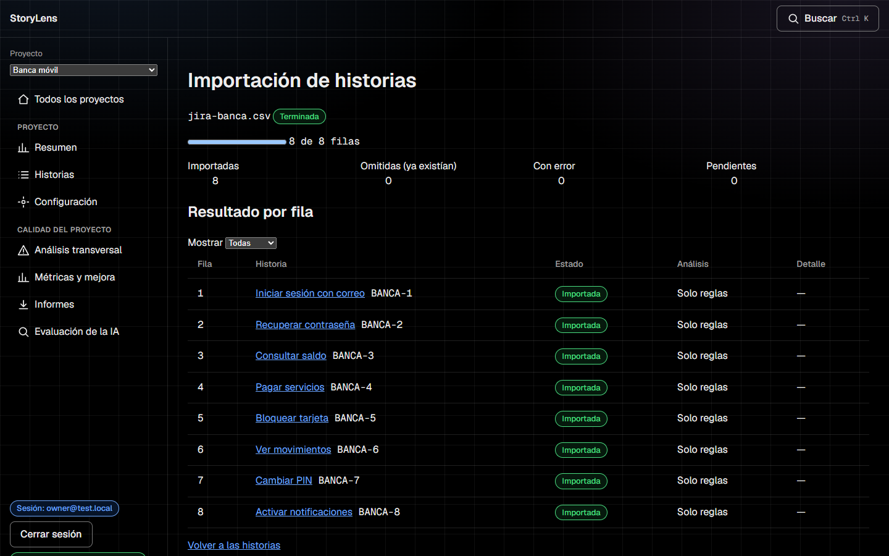<br><sub><b>Importación en segundo plano</b> con resultado por fila y reintento.</sub></td>
    <td width="50%">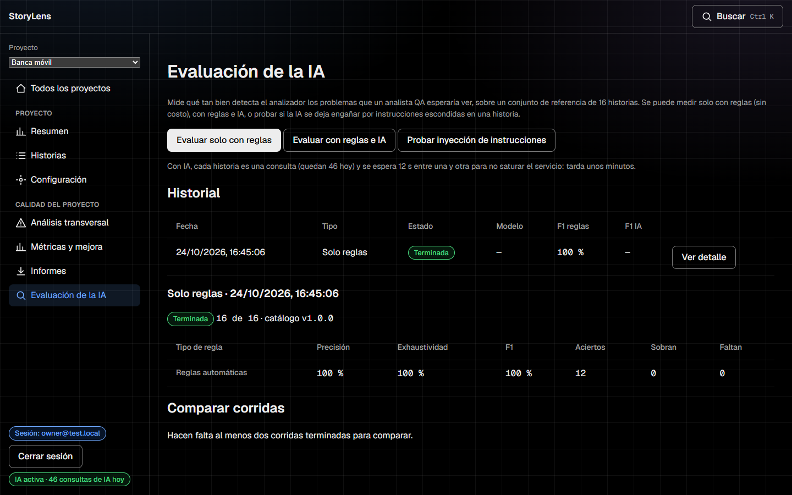<br><sub><b>Evaluación de la IA</b> contra un conjunto de referencia.</sub></td>
  </tr>
</table>

### Modo demo público (solo lectura)

Cualquiera con el enlace ve un proyecto ficticio, sin IA y sin poder modificar nada.

<table>
  <tr>
    <td width="50%">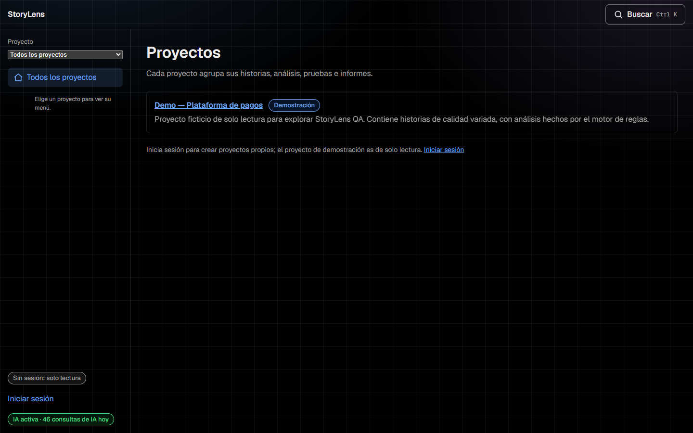</td>
    <td width="50%">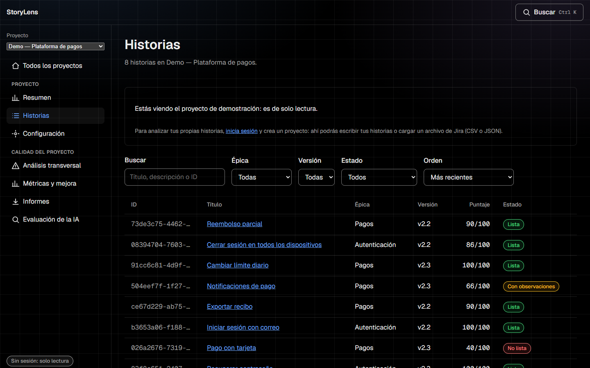</td>
  </tr>
</table>

## Cómo ejecutarlo

**Con Docker** (todo junto, mismo origen):

```bash
cp .env.example .env     # completa OWNER_EMAIL, OWNER_PASSWORD y SESSION_SECRET
docker compose up --build
# http://localhost:8080
```

**En desarrollo**, en dos terminales:

```bash
# Terminal 1: API en http://localhost:8000
cd backend && pip install -e ".[dev]" && uvicorn app.main:app --reload

# Terminal 2: interfaz en http://localhost:5173
cd frontend && npm install && npm run dev
```

Sin sesión se ve la demo de solo lectura. Para crear tus propios proyectos hace falta la cuenta del dueño: define `OWNER_EMAIL`, `OWNER_PASSWORD` y `SESSION_SECRET` en `backend/.env` (hay una plantilla en [`.env.example`](.env.example)). Para activar la IA añade `GEMINI_API_KEY` y `GEMINI_MODEL` (capa gratuita de Google AI Studio); sin ellas todo funciona solo con reglas.

Más detalle: [guía de desarrollo](docs/08-guia-de-desarrollo.md) · [despliegue](docs/09-despliegue.md).

## Pruebas y calidad

| Capa | Comando |
|---|---|
| Backend (pytest, ruff, mypy) | `cd backend && pytest` |
| Frontend (Vitest + Testing Library + axe) | `cd frontend && npm test` |
| Extremo a extremo (Playwright + axe, WCAG 2.1 AA) | `cd frontend && npm run test:e2e` |
| Evaluación de la IA | pantalla «Evaluación de la IA» o `python evaluation/run_eval.py [--ai]` |

Ninguna prueba llama a Gemini. La integración continua ejecuta todo lo anterior en cada cambio y busca secretos en el historial.

## Seguridad y costo cero

- La clave de Gemini vive **solo en el backend**, en una variable de entorno; nunca llega al navegador (la CI lo comprueba sobre el bundle).
- Solo el dueño autenticado puede escribir o usar IA. La demo pública es de solo lectura y sin IA.
- Topes propios y persistentes de IA (5 por minuto, 50 por día): al agotarse, la IA se apaga y la app sigue con las reglas.
- Sesión por cookie firmada, bloqueo temporal ante intentos repetidos de inicio de sesión, límites de tamaño en archivos y evidencias.
- Nada pide tarjeta ni activa facturación en ningún proveedor.

## Arquitectura

Python 3.12 + FastAPI + SQLModel/Alembic por detrás; React 19 + TypeScript + Vite por delante. Arquitectura hexagonal (`domain` → `application` → `infrastructure`/`api`), con el motor de reglas y las métricas como lógica pura y testeable. Más en [`docs/03-arquitectura.md`](docs/03-arquitectura.md) y en las [decisiones de arquitectura](docs/adr/).

## Documentación

| | |
|---|---|
| [Especificación del producto](docs/00-especificacion-del-producto.md) | Visión, módulos, modelo de calidad y criterios de terminado |
| [Visión y alcance](docs/01-vision-y-alcance.md) · [Marco normativo QA](docs/02-marco-normativo-qa.md) | Por qué y con qué normas |
| [Arquitectura](docs/03-arquitectura.md) · [Modelo de datos y API](docs/04-modelo-de-datos-y-api.md) | Cómo está hecho |
| [Integración con Gemini](docs/05-integracion-gemini.md) · [Estrategia de pruebas](docs/06-estrategia-de-pruebas.md) | IA y calidad |
| [Hoja de ruta](docs/07-hoja-de-ruta.md) · [Guía de desarrollo](docs/08-guia-de-desarrollo.md) · [Despliegue](docs/09-despliegue.md) | Cómo seguir |
| [Decisiones de arquitectura (ADR)](docs/adr/) | El porqué de cada decisión importante |

La API se documenta sola: con el backend en marcha, `/docs` (Swagger) y `/openapi.json`.

## Estado

Las siete fases del plan están construidas: fundaciones, frontend, importación masiva, análisis transversal, métricas, evaluación de la IA, y pruebas de extremo a extremo con Docker. Lo que falta y se sabe:

- El despliegue público gratuito está preparado y documentado, pero no ejecutado.
- Las imágenes de evidencia se guardan en disco: en hosts gratuitos sin disco persistente se pierden (las notas y los enlaces no).
- El listado de historias se filtra y pagina en el navegador, pensado para hasta unos 500 por proyecto.

## Licencia

[MIT](LICENSE): puedes usar, copiar, modificar y distribuir el código, incluso con fines comerciales, conservando el aviso de copyright. Se ofrece tal cual, sin garantía.
