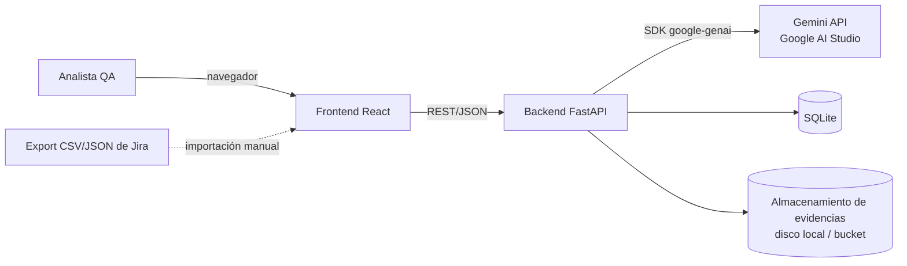
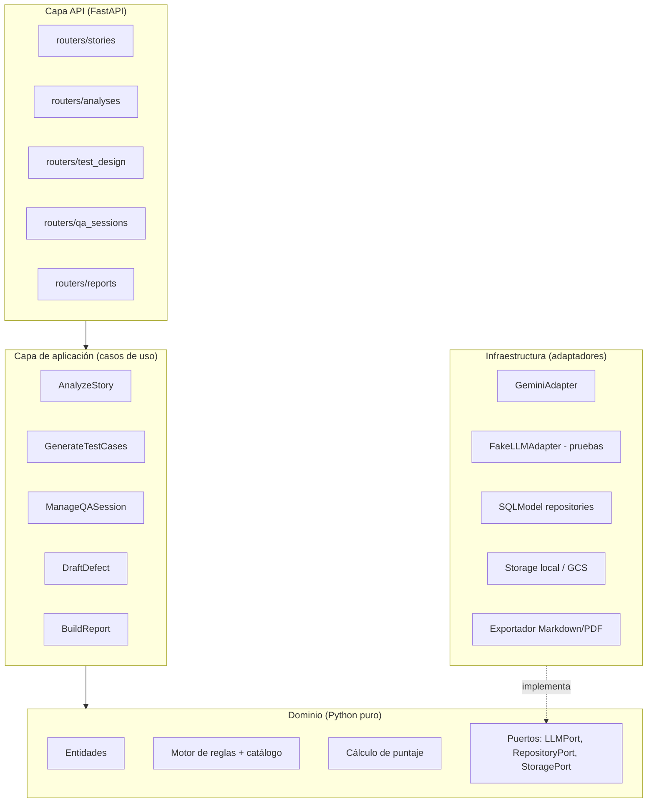
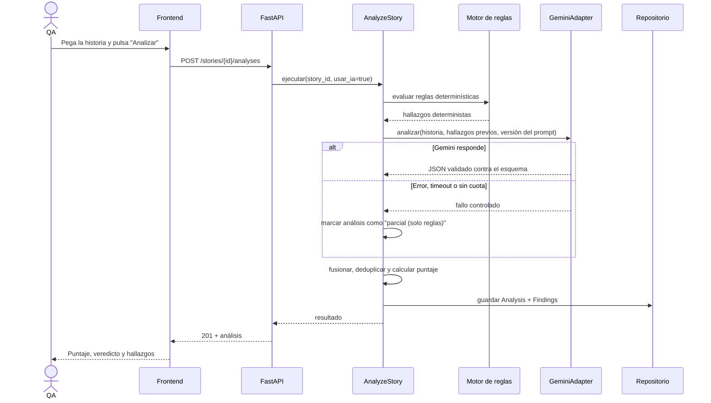

# 03 — Arquitectura

## 1. Principios

1. **Primero las reglas, luego la IA.** El motor determinístico corre siempre; la IA complementa. Sin cuota de Gemini, la app sigue siendo útil (ADR-001).
2. **La API key nunca sale del backend.** El frontend solo habla con nuestra API (ADR-002).
3. **Dominio independiente.** Las reglas y el puntaje no dependen de FastAPI, de la base de datos ni de Gemini (arquitectura hexagonal / *ports & adapters*).
4. **Todo hallazgo es trazable** a una regla del catálogo y a una norma.
5. **La IA propone, el humano decide.** Toda sugerencia de IA se puede aceptar, editar o descartar.

## 2. Vista de contexto



## 3. Vista de componentes (backend)



**Regla de dependencias:** `api → application → domain`. `infrastructure` implementa los puertos del dominio. El dominio no importa nada de las otras capas.

## 4. Flujo principal: analizar una historia



**Decisiones del flujo:**
- Llamada **síncrona** en la v1 (timeout de 30 s en el backend). Si se vuelve lenta, se pasa a tarea en segundo plano con *polling* (`status: pending|done|failed`); el contrato ya incluye `status` para permitirlo sin romper el frontend.
- **Caché** por hash de (texto de la historia + versión del prompt + modelo): el mismo análisis no vuelve a consumir cuota.
- **Deduplicación:** si la IA reporta algo que ya cubre una regla determinística (mismo `rule_id`), gana la determinística.

## 5. Flujo: sesión de revisión en ambiente QA

1. El QA crea la sesión (ambiente, URL, build) a partir de una historia ya analizada.
2. El backend genera el checklist de preparación (plantilla del doc 02 §7) y copia los casos de prueba aceptados.
3. El QA marca los ítems del checklist y el resultado de cada caso, y sube evidencias.
4. Si un caso falla, puede pulsar "Crear borrador de defecto": el backend arma la plantilla 29119-3 y (opcional) pide a Gemini que redacte pasos y resultados a partir de las notas.
5. Al cerrar la sesión, se genera el reporte con la recomendación.

## 6. Frontend

**Organización por funcionalidad (*feature-based*):**

| Pantalla | Ruta | Contenido |
|----------|------|-----------|
| Inicio / historial | `/` | Lista de historias, puntaje, estado |
| Nueva historia | `/stories/new` | Formulario + importación CSV/JSON |
| Análisis | `/stories/:id` | Puntaje, veredicto, hallazgos (aceptar/descartar), Gherkin sugerido |
| Diseño de pruebas | `/stories/:id/tests` | Casos por técnica, matriz de trazabilidad |
| Sesión QA | `/sessions/:id` | Checklist, ejecución, evidencias, defectos |
| Reporte | `/reports/:id` | Vista previa y exportación |

**Librerías sugeridas:** React Router, TanStack Query (estado del servidor), React Hook Form + Zod (formularios y validación), Tailwind + shadcn/ui (componentes accesibles). Los tipos TypeScript del API se **generan** desde el OpenAPI de FastAPI (p. ej. `openapi-typescript`), no se escriben a mano.

## 7. Estructura de carpetas

```
qa-story-reviewer/
├── README.md
├── .env.example
├── .gitignore
├── docker-compose.yml            # backend + frontend para desarrollo local
├── .github/workflows/            # CI: lint, pruebas, build, escaneo de secretos
├── docs/                         # esta documentación + ADR
│   └── adr/
├── backend/
│   ├── pyproject.toml
│   ├── app/
│   │   ├── main.py               # creación de la app FastAPI
│   │   ├── config.py             # settings con pydantic-settings (lee .env)
│   │   ├── api/
│   │   │   ├── routers/          # stories, analyses, test_design, qa_sessions, reports
│   │   │   └── schemas/          # DTOs de entrada/salida (Pydantic)
│   │   ├── application/          # casos de uso
│   │   ├── domain/
│   │   │   ├── entities/
│   │   │   ├── rules/
│   │   │   │   ├── catalog/      # reglas en YAML + diccionario de términos vagos
│   │   │   │   └── engine/       # evaluadores determinísticos
│   │   │   ├── scoring/
│   │   │   └── ports/            # interfaces (LLMPort, repositorios, storage)
│   │   ├── infrastructure/
│   │   │   ├── llm/              # GeminiAdapter, FakeLLMAdapter
│   │   │   ├── persistence/      # modelos SQLModel, repositorios, migraciones (Alembic)
│   │   │   ├── storage/          # evidencias
│   │   │   └── export/           # Markdown / PDF
│   │   └── prompts/              # prompts versionados (v1/, v2/…) + esquemas JSON
│   └── tests/
│       ├── unit/                 # dominio y reglas
│       ├── integration/          # API + base de datos con FakeLLM
│       ├── contract/             # validación de respuestas contra OpenAPI
│       └── fixtures/             # historias de ejemplo, respuestas grabadas de Gemini
├── frontend/
│   ├── package.json
│   ├── src/
│   │   ├── app/                  # router, providers, layout
│   │   ├── features/
│   │   │   ├── stories/
│   │   │   ├── analysis/
│   │   │   ├── test-design/
│   │   │   ├── qa-session/
│   │   │   └── reports/
│   │   ├── shared/               # componentes UI, hooks, utilidades
│   │   └── api/                  # cliente HTTP + tipos generados del OpenAPI
│   └── tests/
│       └── e2e/                  # Playwright + axe
└── evaluation/
    ├── golden-set/               # historias de referencia con hallazgos esperados
    └── reports/                  # resultados de evaluación de la IA por versión de prompt
```

## 8. Atributos de calidad del propio sistema

| Atributo | Decisión |
|----------|----------|
| Seguridad | Key solo en el backend; CORS restringido al dominio del frontend; límite de tamaño de entrada (p. ej. 10 000 caracteres por historia); validación de tipo y tamaño de evidencias (imágenes ≤ 5 MB); *rate limiting* por IP (`slowapi`); escaneo de secretos en CI (gitleaks) |
| Fiabilidad | Reintentos con *backoff* exponencial ante 429/503 de Gemini; *timeout*; degradación a "solo reglas" |
| Desempeño | Caché de análisis; reglas determinísticas < 100 ms |
| Mantenibilidad | Catálogo de reglas como datos; prompts versionados; tipado estricto (mypy, TypeScript `strict`) |
| Observabilidad | Logs estructurados JSON con `request_id`; registrar modelo, versión de prompt, tokens y latencia de cada llamada a Gemini (nunca la key ni el texto completo) |
| Accesibilidad | WCAG 2.2 AA; navegación completa con teclado; colores de severidad con texto/ícono, no solo color |

## 9. Despliegue

| Componente | Opción recomendada | Alternativa |
|-----------|-------------------|-------------|
| Backend | Google Cloud Run (contenedor; key en Secret Manager) | Render, Fly.io |
| Frontend | Vercel o Netlify | Firebase Hosting |
| Base de datos | SQLite en volumen (demo) | Cloud SQL / Neon PostgreSQL |
| Evidencias | Disco local (dev) / Cloud Storage (prod) | |

> Para la demo pública del portafolio: activa un límite diario de análisis por IP y un modo demo con historias de ejemplo precargadas, para no agotar la cuota gratuita.
