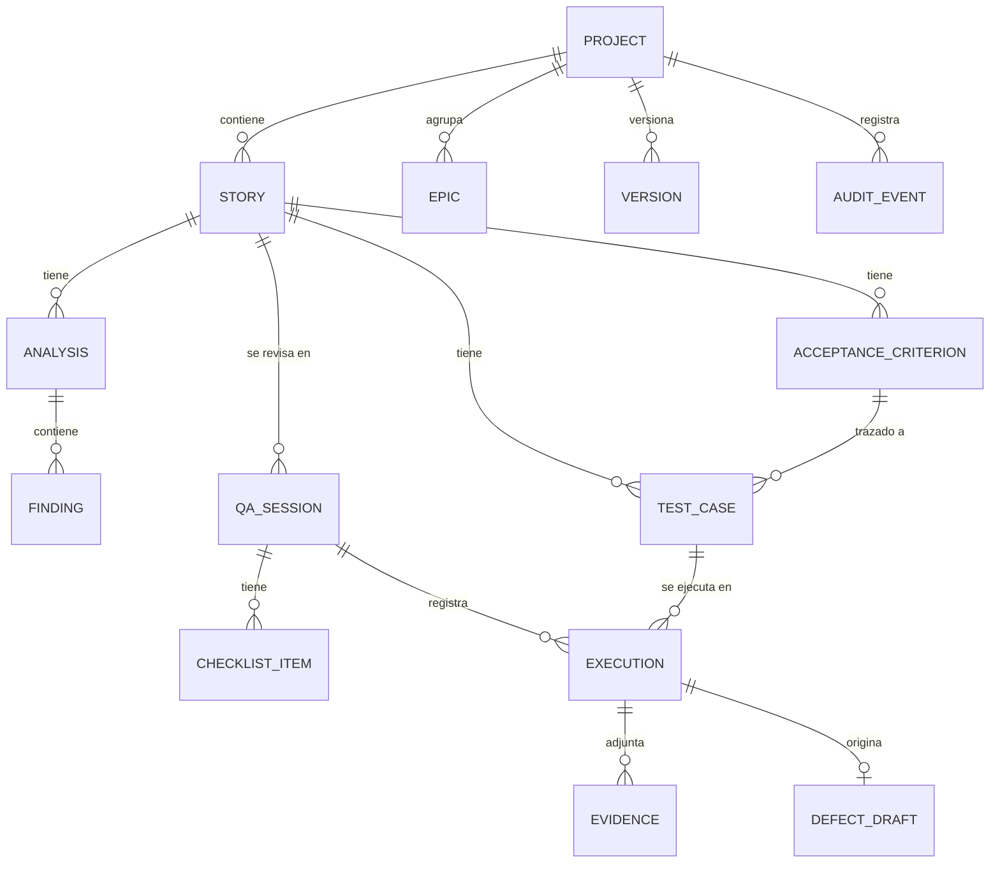

# 04 — Modelo de datos y API

## 1. Modelo de datos



### Entidades

**Project** *(Fase A)*
`id` · `name` · `description` · `objective` · `settings` (JSON: `disabled_rules`, `penalties`, `not_ready_below`, `ready_from`) · `is_demo` · `owner_id` · `created_at`. Cada historia pertenece a un proyecto; los datos de proyectos distintos están aislados. `Epic` y `Version` (`id`, `project_id`, `name`) agrupan historias.

**User** *(Fase A)*
`id` · `email` (único, en minúsculas) · `password_hash` (scrypt). Solo existe la cuenta del dueño (ver ADR-004).

**AuditEvent** *(Fase A)*
`id` (autoincremental) · `at` · `actor` (email o `sistema`) · `action` (`project.created`, `story.imported`, `analysis.run`, `finding.decided`, `session.closed`, `settings.changed`…) · `entity` · `entity_id` · `project_id` · `detail`.

**AIUsage** *(Fase A)*
`id` · `key` (modelo) · `at`. Es el contador persistente de la cuota de IA (ver ADR-005).

`Analysis` guarda además `settings_snapshot`: la configuración del proyecto con la que se calculó, para que el historial no cambie al editar los umbrales.

**Story**
`id` (UUID) · `external_key` (p. ej. "PROJ-123", opcional) · `title` · `description` · `notes` · `priority` · `source` (`manual` | `import_csv` | `import_json`) · `created_at` · `updated_at`

**AcceptanceCriterion**
`id` · `story_id` · `order` · `text` · `format` (`free` | `gherkin`) · `origin` (`user` | `ai_suggested`) · `status` (`active` | `proposed` | `rejected`)

**Analysis**
`id` · `story_id` · `status` (`pending` | `done` | `partial` | `failed`) · `score` (0–100) · `verdict` (`ready` | `ready_with_notes` | `not_ready`) · `used_ai` (bool) · `model_name` · `prompt_version` · `rules_catalog_version` · `input_hash` · `latency_ms` · `created_at`

**Finding**
`id` · `analysis_id` · `rule_id` (del catálogo) · `source` (`rule` | `ai`) · `severity` · `message` · `evidence_text` (fragmento citado) · `suggestion` · `reference` (norma) · `confidence` (solo IA, 0–1) · `user_decision` (`pending` | `accepted` | `dismissed`) · `dismiss_reason`

**TestCase**
`id` · `story_id` · `criterion_id` (nullable) · `title` · `technique` (`equivalence_partitioning` | `boundary_value` | `decision_table` | `state_transition` | `scenario` | `error_guessing`) · `preconditions` · `steps` (lista) · `test_data` · `expected_result` · `priority` · `origin` (`user` | `ai_suggested`) · `status` (`proposed` | `accepted` | `rejected`)

**QASession**
`id` · `story_id` · `environment_name` · `environment_url` · `build_version` · `tester_name` · `started_at` · `closed_at` · `recommendation` (`accept` | `accept_with_minor_defects` | `reject`) · `summary`

**ChecklistItem**
`id` · `session_id` · `phase` (`preparation` | `execution` | `closure`) · `text` · `checked` · `note`

**Execution**
`id` · `session_id` · `test_case_id` · `result` (`passed` | `failed` | `blocked` | `not_run`) · `actual_result` · `notes` · `executed_at`

**Evidence**
`id` · `execution_id` · `type` (`image` | `link` | `note`) · `uri` · `description` · `uploaded_at`

**DefectDraft**
`id` · `execution_id` · campos de la plantilla 29119-3 (ver doc 02 §6) · `exported` (bool)

## 2. API REST (v1)

### Proyectos, acceso y auditoría *(Fase A)*
| Método | Ruta | Descripción |
|--------|------|-------------|
| POST/GET | `/projects` | Crear / listar (el anónimo solo ve la demo) |
| GET/PATCH/DELETE | `/projects/{id}` | Detalle / editar nombre, objetivo y `settings` / borrar con todo su contenido |
| POST/GET | `/projects/{id}/epics`, `/projects/{id}/versions` | Épicas y versiones |
| POST/GET | `/projects/{id}/stories` | Crear / listar (`?epic_id=&version_id=`) |
| POST | `/projects/{id}/stories/import`, `/projects/{id}/stories/import:confirm` | Importación con vista previa; los duplicados se detectan dentro del proyecto |
| GET | `/projects/{id}/audit?limit=&offset=` | Historial de acciones, el más reciente primero |
| POST | `/auth/login`, `/auth/logout` · GET `/auth/me` | Sesión del dueño |

Los recursos por id (`/stories/{id}`, `/analyses/{id}`, `/qa-sessions/{id}`…) conservan su ruta y comprueban a qué proyecto pertenecen. Escribir exige sesión (401) y no se permite en la demo (403); leer un proyecto ajeno responde 404.

Base: `/api/v1`. JSON. Errores con formato **RFC 9457 (Problem Details)**: `type`, `title`, `status`, `detail`, `instance`.

### Historias
| Método | Ruta | Descripción |
|--------|------|-------------|
| POST | `/stories` | Crear historia (con criterios) |
| POST | `/stories/import` | Importar CSV/JSON (multipart) → devuelve vista previa del mapeo; no guarda nada |
| POST | `/stories/import:confirm` | Crea las filas elegidas (`selected`) releyendo el mismo archivo y mapeo |
| GET | `/stories` | Listar (paginado: `?page=&size=&q=`) |
| GET | `/stories/{id}` | Detalle con criterios y último análisis |
| PATCH | `/stories/{id}` | Editar |
| DELETE | `/stories/{id}` | Eliminar |

### Análisis
| Método | Ruta | Descripción |
|--------|------|-------------|
| POST | `/stories/{id}/analyses` | Ejecutar análisis. Cuerpo: `{ "use_ai": true }` |
| GET | `/analyses/{id}` | Resultado con hallazgos |
| PATCH | `/findings/{id}` | `{ "user_decision": "dismissed", "dismiss_reason": "..." }` → recalcula el puntaje |
| GET | `/rules` | Catálogo de reglas (para mostrar referencias en la UI) |

### Diseño de pruebas
| Método | Ruta | Descripción |
|--------|------|-------------|
| POST | `/stories/{id}/acceptance-criteria:suggest` | Gherkin sugerido por IA (estado `proposed`) |
| POST | `/stories/{id}/test-cases:generate` | Casos sugeridos. Cuerpo: `{ "techniques": [...] }` |
| GET | `/stories/{id}/test-cases` | Listar |
| PATCH | `/test-cases/{id}` | Editar / aceptar / rechazar |
| GET | `/stories/{id}/traceability` | Matriz criterio ↔ casos |

### Sesiones QA
| Método | Ruta | Descripción |
|--------|------|-------------|
| POST | `/stories/{id}/qa-sessions` | Crear sesión (genera checklist y ejecuciones) |
| GET | `/qa-sessions/{id}` | Detalle |
| PATCH | `/checklist-items/{id}` | Marcar ítem |
| PATCH | `/executions/{id}` | Registrar resultado |
| POST | `/executions/{id}/evidences` | Subir evidencia (multipart) |
| POST | `/executions/{id}/defect-draft` | Crear borrador de defecto (`{ "use_ai": true }`) |
| POST | `/qa-sessions/{id}:close` | Cerrar con recomendación |

### Reportes y sistema
| Método | Ruta | Descripción |
|--------|------|-------------|
| GET | `/analyses/{id}/report?format=md\|pdf` | Reporte de análisis |
| GET | `/qa-sessions/{id}/report?format=md\|pdf` | Reporte de sesión |
| GET | `/health` | Estado (incluye si la IA está configurada, sin exponer la key) |

### Ejemplo de respuesta de análisis (contrato)

```json
{
  "id": "6f1c…",
  "story_id": "a2b9…",
  "status": "done",
  "score": 62,
  "verdict": "ready_with_notes",
  "used_ai": true,
  "model_name": "gemini-…",
  "prompt_version": "analysis-v1",
  "findings": [
    {
      "id": "f01…",
      "rule_id": "US-AMB-001",
      "source": "rule",
      "severity": "major",
      "message": "El criterio 2 usa el término vago «rápidamente».",
      "evidence_text": "el sistema responde rápidamente",
      "suggestion": "Defina un umbral medible, p. ej. «en menos de 2 segundos en el p95».",
      "reference": "ISO/IEC/IEEE 29148:2018 — característica 'no ambiguo'",
      "confidence": null,
      "user_decision": "pending"
    }
  ]
}
```

## Notas de implementación (Fase 3)

Diferencias deliberadas respecto al diseño inicial:

- **Criterios por posición, no como entidad.** Un caso se vincula a un criterio con `criterion_index` (1 = primer criterio). Basta mientras las historias no se editen; si se añade edición, habrá que promover los criterios a entidad con id propio.
- **Gherkin sugerido no se persiste.** `POST /stories/{id}/gherkin:suggest` devuelve escenarios para copiar; solo se conservan los que tienen estructura Cuando/Entonces.
- **Regenerar casos** (`POST /stories/{id}/test-cases:generate`) reemplaza únicamente los casos de IA en estado `proposed`; los aceptados, rechazados y escritos por el usuario se conservan. Si la IA falla o no produce ningún caso válido, no se borra nada.
- **Un caso creado a mano** (`POST /stories/{id}/test-cases`) nace `accepted` con origen `user`.
- **Errores de IA** en estos endpoints: `503` si no hay IA o no responde, `502` si responde fuera del esquema o sin casos válidos (formato Problem Details).

## Notas de implementación (Fase 4)

Reglas de negocio de la sesión de revisión, tal como quedaron implementadas:

- **Una sesión nace de los casos aceptados** de la historia. Sin ninguno, `POST /stories/{id}/qa-sessions` responde `422`. La URL del ambiente debe ser `http` o `https`.
- **Sesión cerrada = inmutable.** Cambiar el checklist, un resultado, una evidencia o un defecto en una sesión cerrada responde `409`.
- **Cierre** (`POST /qa-sessions/{id}:close`): exige que todos los casos tengan resultado (`409` si faltan) y no permite recomendar `accept` si hay casos fallidos o bloqueados (`422`). El campo `suggested_recommendation` es una ayuda: sin defectos de severidad mayor sugiere aceptar; con solo defectos menores o triviales, aceptar con defectos menores; en cualquier otro caso, rechazar. La decisión final es del analista.
- **Defecto** (`POST /executions/{id}/defect-draft`): solo para ejecuciones fallidas (`409` si no); hay uno por ejecución y regenerar lo reemplaza. Siempre se arma una plantilla con datos reales de la sesión; con `use_ai` la IA solo mejora la redacción (no toca ambiente, build ni frecuencia). Si la IA falla, queda la plantilla y `ai_status` lo indica.
- **Evidencias**: nota (texto), enlace (solo `http`/`https`) o imagen (`POST /executions/{id}/evidences/image`, multipart). Las imágenes se aceptan por su **contenido real** (PNG, JPEG o WebP), nunca por el nombre ni el `Content-Type` declarado; máximo 5 MB (`MAX_EVIDENCE_MB`). Se guardan con un nombre generado (UUID) en `EVIDENCE_DIR` y se sirven con `X-Content-Type-Options: nosniff`. Una petición con `Content-Length` muy superior al límite se rechaza con `413` antes de procesarla.
- **Borrar una historia** elimina también sus sesiones, defectos y los archivos de evidencia.
